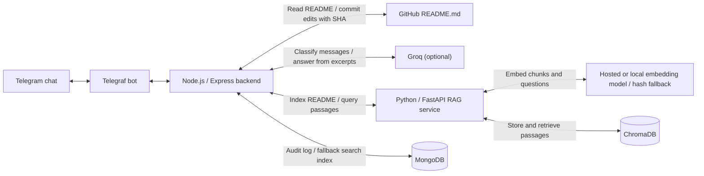

# Remember Me

A second brain you can message on Telegram. Send a link, a reminder, or a note. The bot files it in a GitHub README, then makes it searchable. You can open the same file on GitHub to browse it or edit it by hand.

## A conversation with your notebook

| Send this in Telegram | What happens |
| --- | --- |
| `/add Kubernetes https://kubernetes.io Container orchestration` | Saves a clickable entry under **Links**. |
| `The spare automobile key is inside the striped biscuit tin.` | Saves the sentence under **Notes**. |
| `Remind me to return the library books on Friday` | Saves the task under **Reminders** for later recall. |
| `/add [Books] Invisible Cities - Italo Calvino` | Creates or reuses the **Books** section. |
| `Where did I put the backup car keys?` | Searches for relevant entries. With Groq enabled, it answers from those entries. |
| `/update Kubernetes https://kubernetes.io Cluster scheduler` | Replaces the matching bullet in place. |
| `/delete Kubernetes` | Removes the matching bullet. An ambiguous target prompts you to be more specific. |

The first four messages produce a notebook like this:

```markdown
# Second Brain

## Links

- [Kubernetes](https://kubernetes.io) - Container orchestration

## Notes

- The spare automobile key is inside the striped biscuit tin.

## Reminders

- return the library books on Friday

## Books

- Invisible Cities - Italo Calvino
```

Reminders are searchable notes. Delivery at a scheduled time is outside the current feature set.

## Run it

1. Create a Telegram bot with [BotFather](https://t.me/BotFather). Choose a GitHub repository and an existing branch for your notebook. A dedicated private repository keeps your personal entries together. Give the bot a fine-grained GitHub token with **Contents — Read and write** on that repository.
2. Create the configuration files if this is a fresh checkout.

   ```sh
   cp -n backend/.env.example backend/.env
   cp -n rag/.env.example rag/.env
   ```

3. Set `TELEGRAM_BOT_TOKEN`, `GITHUB_OWNER`, `GITHUB_REPO`, and `GITHUB_TOKEN` in `backend/.env`. Set `GITHUB_BRANCH` if you use a branch other than `main`. Add your numeric Telegram ID to `TELEGRAM_ALLOWED_USER_IDS` to limit who can read or change the notebook. Set `BACKEND_API_SECRET` to protect the HTTP API.
4. Start the services.

   ```sh
   docker compose up --build
   ```

5. Open the bot and send `/status`. Send `/sync` to import an existing README, or `/add My first note` to start one. The first search also imports an existing README when the local index is empty. The first local model download can take a few minutes.

### Optional AI settings

| File | Setting | Purpose |
| --- | --- | --- |
| `backend/.env` | `GROQ_API_KEY` | Enables natural-language classification and answers grounded in retrieved passages. Without it, the bot uses command and keyword rules and returns ranked excerpts. |
| `backend/.env` | `GROQ_MODEL` | Selects the Groq model. The default is `openai/gpt-oss-20b`. |
| `rag/.env` | `HUGGINGFACE_MODEL` | Defaults to `sentence-transformers/all-MiniLM-L6-v2`. The local model provides semantic retrieval even without Groq. |
| `rag/.env` | `HUGGINGFACE_API_KEY` | Tries hosted inference first. With no key or a failed hosted request, the service tries the local model. Compose persists downloaded models. |
| `rag/.env` | `EMBEDDING_BACKEND` | Choose `huggingface` (default), `hash` for offline keyword matching, or `openai` with `OPENAI_API_KEY`. |

MongoDB stores the audit history and a fallback search index. Compose supplies `MONGODB_URI` and `RAG_SERVICE_URL` and persists MongoDB and ChromaDB in named volumes. Only one backend instance should poll a given Telegram bot.

## Architecture



## How a message becomes an answer

1. **Classify.** Slash commands have fixed meanings. Free-form messages use Groq when available and fall back to local rules. Explicit questions search the notebook.
2. **Save.** The backend fetches the current README and formats the entry as one bullet in its section. It commits changed content using the SHA it actually read. An identical entry in the same section needs no new commit. If a GitHub edit conflicts, the bot reports the conflict.
3. **Preprocess and index.** The indexer splits Markdown into whole sections and individual bullets. Each chunk keeps its section and original text, including URLs. Heading-only sections produce no matches. The Python service embeds the chunks and publishes a complete Chroma index. MongoDB also receives a snapshot for the same README revision.
4. **Retrieve.** The question is embedded with the encoder that built the index. The service ranks passages, checks relevance, and suppresses duplicate list sections. When the semantic encoder is unavailable, matching terms provide a fallback. The backend checks the README revision before trusting remote results and rebuilds a stale remote index on the next search.
5. **Answer.** Groq receives the question and the selected passages. Without Groq, the bot shows the matching text with section labels. With no relevant passages, it reports that it found no strong match.

The GitHub README is the source of truth. A pending-write marker lets the next search recover if the backend stops between a GitHub commit and index publication. Run `/sync` after editing it directly, including after restoring an older commit. When upgrading from the older index format, `/sync` rebuilds both indexes from that same file.

## Commands and recovery

| Command | Behavior |
| --- | --- |
| `/help`, `/start` | Show examples and commands. |
| `/add`, `/create`, `/new` | Save a note or link. Use `[Section]` after the command to choose a section. |
| `/get`, `/find`, `/search` | Find entries by topic. Natural-language questions also work. |
| `/update`, `/edit` | Edit by topic or title. If nothing matches, append a new entry and report it. Use `title - description` for a titled note. |
| `/delete`, `/remove` | Delete a matching entry. A missing or ambiguous target leaves the file intact. |
| `/status` | Show uptime, MongoDB state, GitHub and Groq configuration, RAG reachability, and the encoder used by published indexes. |
| `/sync` | Read GitHub again and rebuild both indexes. The reply identifies which search service is available. |
| `/reset CONFIRM [replacement text]` | Clear or replace the entire notebook and rebuild search. A bare `/reset` displays the confirmation instructions. GitHub retains the previous commit. |

If paraphrases stop matching, send `/status`. A hash index can find shared terms such as “library” but may miss a paraphrase. Restore access to the local model or hosted provider, then send `/sync` to rebuild semantic embeddings. For a GitHub permissions error, check the configured repository, branch, and token permissions.

## Local development

Run MongoDB locally or set `MONGODB_URI` in `backend/.env`. With the configuration files above, start the services in separate terminals.

```sh
cd rag
python3 -m venv .venv
. .venv/bin/activate
pip install -r requirements.txt
uvicorn app.main:app --host 127.0.0.1 --port 8001
```

```sh
cd backend
npm ci
npm run build
npm start
```

The backend exposes `GET /health`, `GET /api/status`, `POST /api/reader` (JSON with a `message` string), `POST /api/sync`, and `POST /api/reset`. Direct API reset accepts an optional `content` string and acts immediately. Send the `x-api-key` header on all `/api/*` requests when a shared secret is configured. FastAPI exposes `/health`, `/index`, `/query`, and interactive documentation at `/docs`.

Run the backend checks with `npm test` and `npm run build` in `backend/`. Run `python -m pytest` in the activated `rag/` environment. The automated suites use fixtures and temporary indexes. They require no production credentials.

To repeat the paraphrase check with the real MiniLM model already cached, run `HF_HUB_OFFLINE=1 RUN_LOCAL_MODEL_TESTS=1 python -m pytest` in the RAG environment.
